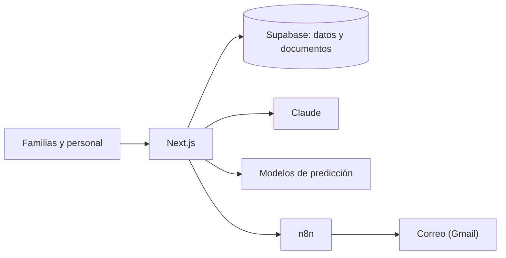

# Nodo · Sistema de Admisión, Matrículas y Cobranzas

Hackatón · Track T3

Plataforma para la **Unidad Educativa Nodo** (institución ficticia): la familia postula en línea, sube sus documentos, revisa sus pagos y resuelve dudas con **Clipo**, el asistente virtual. El personal gestiona solicitudes, matrículas y cobros desde un panel.

## Qué hace

1. **Admisión en línea:** formulario y subida de documentos. La familia recibe un código de seguimiento.
2. **Revisión de documentos con IA:** señala observaciones para secretaría. La decisión la toma una persona.
3. **Matrícula automática:** al aprobar una solicitud se crean la matrícula, su cuota y las 10 pensiones.
4. **Avisos con n8n:** código de seguimiento, solicitud aprobada y recordatorios de pago.
5. **Pagos (demostración):** no se cobra dinero. La matrícula se activa al quedar pagada su cuota.
6. **Beca por puntualidad:** récord de pagos y beca del 20 % como incentivo.
7. **Panel:** solicitudes, matrículas, pagos, auditor de procesos y modelos de predicción.

## Problema

El seguimiento manual de admisiones, matrículas y pensiones consume tiempo al personal, puede retrasar los cobros y deja a las familias sin información clara sobre sus trámites y pagos.
**Dato:** en Ecuador, el 64 % de los colegios particulares cierra cada mes con más del 5 % de cartera vencida y el 16 % supera el 20 % (informe de Mattilda sobre 173 colegios, citado por Revista Gestión en 2025).

**Referencia:** [Primicias · Revista Gestión, 29-08-2025](https://www.primicias.ec/revistagestion/analisis/clases-ecuador-estudiantes-economia-hogares-educacion-privada-103881/)

En nuestro dataset **ficticio**, el 6,0 % de lo facturado entre septiembre de 2025 y enero de 2026 seguía impago al corte (USD 12 108 de 200 679). No se mide igual que en el informe, así que solo sirve como referencia para los casos de ejemplo.

**Validación:** la hipótesis se revisó y aprobó en una charla con mentores. Además, se entrevistó a miembros del equipo y un total de 7 personas externas para saber si este problema era recurrente en su experiencia como usuarios.

## Usuario

- **Principal:** personal de secretaría y colecturía que gestiona matrículas y cobros.
- **Externo:** representante del estudiante que realiza el trámite y necesita resolver dudas.

El sitio también busca tener en cuenta a minorías, como niños con autismo y personas no videntes (ver [Accesibilidad e inclusión](#accesibilidad-e-inclusión)).

## Arquitectura



- **Next.js:** interfaz y backend del sistema.
- **Supabase:** base de datos y almacenamiento privado de documentos.
- **Claude:** asistente Clipo, revisión de documentos y auditor de procesos. Sin clave de API, Clipo es simulado, el auditor usa solo reglas y los documentos se revisan a mano.
- **Modelos de predicción:** estiman el riesgo de atraso o impago.
- **n8n:** recibe los avisos de la app y envía los correos a las familias.

## Cómo correr

Requisitos: Node 22+ y pnpm 10.

```bash
pnpm install
pnpm dev          # http://localhost:3000
```

Funciona **sin ninguna variable de entorno**: usa datos simulados en memoria (se reinician al reiniciar el servidor) y un asesor IA simulado. Copia `.env.example` a `.env.local` para activar servicios reales:

| Variable | Efecto |
|---|---|
| `ANTHROPIC_API_KEY` | Clipo, la revisión de documentos y el auditor usan Claude (`ANTHROPIC_MODEL` es opcional; por defecto `claude-opus-5-5`). El modo voz usa el mismo modelo, con un prompt de estilo oral. |
| `SUPABASE_URL` + `SUPABASE_SERVICE_ROLE_KEY` | Los datos y documentos se guardan en Supabase (ver «Preparar Supabase»). |
| `ADMIN_PASSCODE` + `SESSION_SECRET` | Acceso al panel. En desarrollo, sin ellas se usa `admin-demo`. **En producción son obligatorias** (≥16 y ≥32 caracteres); si faltan, el panel queda cerrado. |
| `N8N_WEBHOOK_SECRET`, `N8N_OUTBOUND_WEBHOOK_URL` | Integración con n8n (ver `n8n/README.md`). Sin `N8N_WEBHOOK_SECRET` el webhook responde 401 en todos los entornos. |
| `APP_URL` | URL pública de la app para los enlaces de los correos. |
| `DEMO_TODAY` | Fecha del reloj de la demo. Con Supabase y el dataset usa `2026-01-31T15:00:00Z`; si falta, la app usa la fecha real y las pensiones del dataset aparecen vencidas. |
| `NEXT_PUBLIC_APP_NAME` | Opcional: nombre de la app (por defecto `Nodo`). |
| `SUPABASE_DB_URL` | No la usa la app. Solo sirve para cargar migraciones y datos desde la terminal. |

`NEXT_PUBLIC_SUPABASE_URL` y `NEXT_PUBLIC_SUPABASE_ANON_KEY` están reservadas para una fase futura y todavía no se usan.

### Preparar Supabase

1. Aplica en orden los archivos de `supabase/migrations/` (con `psql` o en el editor SQL de Supabase).
2. Aplica `supabase/seed.sql` (dataset ficticio).
3. Opcional: aplica `supabase/seed/demo_solicitudes.sql` para ver solicitudes de ejemplo en el panel.

### Scripts

`pnpm dev` · `pnpm build` · `pnpm start` · `pnpm lint` · `pnpm typecheck` · `pnpm db:seed`

### Datos

**Todos los datos son ficticios.** La base es el dataset `dataset-ficticio-colegio/` (240 estudiantes, año 2025-2026, corte enero 2026). Además, un script del equipo genera datos de demostración inventados para completar el panel (ver `data/README.md`). En el dataset, estudiantes y representantes se identifican con códigos (`EST-###`, `REP-###`).

En la demo no se deben usar datos ni documentos de personas reales. Para probar los correos, usa cuentas del equipo.

- Modo simulado: los CSV se cargan en memoria al arrancar y el reloj de la demo arranca el 31 ene 2026 (`DEMO_TODAY` lo cambia).
- Supabase: `pnpm db:seed` regenera `supabase/seed.sql` desde los CSV (incluye asistencia, notas, horarios y docentes).

### Datos de demostración

- Pagos (`/pagos`): estudiante `EST-001` o `MAT-2025-0001`, representante `REP-001`.
- Estado de solicitud (`/estado`): envía una en `/admision` y usa el código y la cédula ficticia que registres.
- Panel (`/admin`): clave `admin-demo` (solo con `pnpm dev`; en `pnpm start` define `ADMIN_PASSCODE` y `SESSION_SECRET`).
- Las solicitudes nuevas reciben un código aleatorio, p. ej. `ADM-2026-K7P2QX`.
- Modelos de cobranza: `/admin/modelos` (familias con historial de pagos) y `/admin/nuevo-cliente` (familias nuevas).

## IA y automatización

| Parte | Cómo funciona | Límites y fallos |
|---|---|---|
| Clipo, asistente virtual (burbuja y `/asesor`) | Responde consultas de admisión, matrícula y pagos con la información de la institución, por texto o voz. Con `ANTHROPIC_API_KEY` responde Claude; sin ella es **simulado** y usa palabras clave. | No tiene herramientas ni acceso a datos de las familias. Puede equivocarse y lo avisa; si falla, el error se muestra en pantalla. Las conversaciones se guardan en la base. |
| Revisión de documentos | Después de subir los documentos, Claude los revisa (incluido el estado de cuenta) y señala observaciones e inconsistencias. La app calcula la capacidad de pago con reglas fijas. El personal puede repetir la revisión. | Los documentos se envían a la API de Anthropic. Es solo un apoyo: no aprueba ni rechaza. Sin clave, la revisión es manual. |
| Auditor de procesos (panel) | Revisa solicitudes y pagos con reglas fijas. Con la clave, Claude además prioriza y amplía los hallazgos, sin recibir nombres, cédulas ni contactos. | Sin clave quedan los resultados de las reglas. |
| Predicción de pago (`/admin/modelos`) | Regresión logística, árbol de decisión y random forest, entrenados solo con datos sintéticos. Leen los pagos registrados en la app. | Solo 2 meses de entrenamiento. Con los datos originales, su exactitud queda por debajo de suponer que «todos pagan puntual». Solo sirven como alerta temprana, no para sancionar. |
| Familia nueva (`/admin/nuevo-cliente`) | Estima el riesgo de impago sin historial. | La señal es débil, apenas mejor que el azar. Nunca debe usarse para negar una matrícula. |
| n8n | La app envía los eventos a un webhook protegido con una clave. n8n arma el mensaje y envía el correo por Gmail: código de seguimiento, solicitud aprobada y recordatorio de pago (flujo en `n8n/workflows/codigo-seguimiento.json`). | Sin n8n, la solicitud se guarda igual y no se envía correo. La app confirma que n8n recibió el aviso, no que el correo llegó: eso se revisa en n8n. |

> **Nota:** el uso de inteligencia artificial puede causar errores; se ha hecho un proceso de enseñanza al modelo LLM para reducir esto (mediante instrucciones y el contexto de la institución, sin reentrenarlo).

### Voz

El modo voz usa el reconocimiento y las voces **propias del navegador** (Web Speech). El equipo probó las voces en Chrome, Edge y Firefox. En **Brave** no funciona por restricciones del propio navegador. Para hablar por micrófono, el navegador debe tener reconocimiento de voz; si no lo tiene, la app avisa y se puede escribir. Según el navegador, el audio puede procesarse en un servicio externo; nuestro servidor no lo guarda.

### Récord de puntualidad y beca

Cada una de las 10 pensiones suma 10 % si se paga a tiempo, 5 % si se paga con atraso y 0 % si no se paga. Con 80 % o más y ningún mes sin pagar, la familia gana una beca del 20 % en la pensión del año siguiente. Colecturía la confirma; el sistema no aplica el descuento de forma automática.

### Qué es de demostración

- No hay pasarela de pago. En `/pagos` la familia elige registrar un pago como puntual o atrasado (con fecha simulada) y puede deshacerlo. **Esta función es solo para la demo** y debe quitarse antes de un uso real.
- La clave compartida del panel es provisional.

## Adopción y viabilidad

**Objetivo:** reducir al máximo la cartera vencida. La beca es una inversión para lograrlo. El resultado todavía no está medido.

**Quién lo usa:** secretaría, colecturía y las familias.

| Paso | Qué incluye |
|---|---|
| 1. Despliegue | Publicar la app con Supabase y configurar las variables de producción, la clave del panel y el correo institucional. |
| 2. IA de consulta | Clipo atiende dudas de admisión, matrícula y pagos. Las decisiones siguen en manos del personal. |
| 3. n8n en el flujo de trabajo | Conectar los avisos y recordatorios al proceso de secretaría y colecturía, y activar el recordatorio diario. |
| 4. Beca del 20 % | Usarla como incentivo para pagar a tiempo. |

**Antes de usar datos reales** faltan, como mínimo: usuarios y roles para el personal, quitar los pagos de demostración y revisar el tratamiento de datos personales según la LOPDP.

### Costo mensual aproximado

Estimación para un colegio de 240 estudiantes, con precios de lista consultados el 28-11-2026, sin impuestos.

| Servicio | USD al mes |
|---|---|
| Hosting: [Vercel Pro](https://vercel.com/pricing), 1 usuario | 20 |
| Base de datos: [Supabase Pro](https://supabase.com/pricing), 1 proyecto | 25 |
| Automatización: [n8n Cloud Starter](https://n8n.io/pricing/) (aprox., pago mensual) | 24 |
| [API de Claude](https://platform.claude.com/docs/en/about-claude/pricing), Opus 5.5 (uso estimado de unos 19, con margen) | 25 |
| **Total aproximado** | **94** (USD 1 128 al año) |

### Cómo se optimiza el tiempo (ejemplo ficticio)

Colegio de ejemplo con 240 estudiantes y una cartera vencida inicial del 20 % (el nivel crítico del dato estadístico). Cada mes hay 240 recordatorios, 150 consultas y un seguimiento por cada pensión vencida. **Cantidades y minutos son supuestos.**

| Etapa | Qué cambia | Horas al mes | Horas liberadas frente al trabajo manual |
|---|---|---|---|
| Manual | Recordatorio 3 min, consulta 5 min, seguimiento 15 min (48 vencidas) | 36,5 | 0 |
| 1. Avisos con n8n | El recordatorio baja a 0,25 min | 25,5 | 11,0 |
| 2. Más Clipo | Resuelve el 35 % de las consultas | 21,1 | 15,4 |
| 3. Programa optimizado | La cartera baja al 11 % (unas 26 vencidas) y el seguimiento a 5 min | 11,3 | **25,2** |

En el ejemplo, el tiempo de estas tareas baja un 69 %. La etapa 1 supone la app publicada y el recordatorio diario activo.

### La beca como inversión: cómo hacerla viable (ejemplo ficticio)

La beca busca reducir al máximo la cartera vencida. Su costo se controla con un **cupo anual**, con prioridad para las familias que mejoren su récord. En el mismo colegio, la facturación es de USD 444 000 al año (240 × USD 185 × 10) y cada beca del 20 % cuesta USD 370.

| Valores anuales en USD | A: avisos e IA, sin beca | B: beca sin cupo | C: beca con cupo (optimizado) |
|---|---|---|---|
| Cartera vencida (hoy 20 %) | 17 % | 10 % | 11 % |
| Lo que deja de quedar vencido | 13 320 | 44 400 | 39 960 |
| Becas | 0 | 120 (44 400) | 40 (14 800) |
| Operación | 1 128 | 1 128 | 1 128 |
| Valor del tiempo liberado (USD 5 por hora, 10 meses) | 1 199 | 1 269 | 1 259 |
| **Resultado estimado** | **13 391** | **141** | **25 291** |

`resultado = lo que deja de quedar vencido − becas − operación + valor del tiempo`

En este ejemplo, el cupo permite un resultado mucho mayor: aunque la cartera baje un punto menos que sin cupo, el costo en becas se reduce en dos tercios. El escenario C cubre sus costos si la cartera baja de 20 % a menos de **16,7 %**, y supera al escenario A si baja a menos de **13,7 %**.

**Supuestos:** el efecto sobre la cartera y el número de becas no están medidos. Se cuenta como beneficio lo que deja de quedar vencido, suponiendo que de otro modo no se cobraría en el año. El valor del tiempo son horas liberadas, no dinero en caja. La beca se descuenta en la pensión del año siguiente.

**Cómo saber si funciona:** cada trimestre, comparar la cartera vencida, el costo de las becas y las horas del personal con la situación inicial, y ajustar el cupo.

## Accesibilidad e inclusión

- **Panel de accesibilidad** (icono de una persona): tema, tamaño del texto, alto contraste, reducir movimiento, reducir transparencia y fuente de lectura fácil.
- **Colores de error suaves:** usamos un rojo poco saturado, pensando en personas con sensibilidad sensorial, como algunos niños con autismo.
- **No dependemos solo del color:** el error de un campo tiene un icono y un texto, y el formulario de admisión dice qué campo falta.
- **Lectores de pantalla y teclado (ARIA):** enlace para saltar al contenido, campos con etiqueta, errores y ayudas unidos a su campo, campos obligatorios marcados, avisos del chat y de las búsquedas, y tablas de datos para los gráficos.

## Entrega

La versión que se evalúa es la del tag `entrega`, que debe publicarse antes de las **14:00 del sábado 28-11-2026** y no moverse después. Pasos, con los cambios ya en `main`:

```bash
git push origin main
git tag -a entrega -m "Entrega hackatón T3"
git push origin entrega
git ls-remote --tags origin    # comprobar que el tag está publicado
```

## Estructura

```
src/
  app/(public)/      landing, admisión, estado, pagos, asesor IA
  app/admin/         login + panel (dashboard, solicitudes, matrículas, pagos, auditoría, modelos, cliente nuevo)
  app/api/           chat, solicitudes y documentos, consultas, pagos de demo, recordatorios, admin, webhook n8n, health
  ai/                proveedor Claude / simulado, prompts, revisión de documentos, auditor (reglas + IA)
  content/institution.ts   contexto institucional editable (ficticio)
  data/              repositorio (memoria o Supabase), documentos y plan de matrícula
  components/        UI glass, accesibilidad, gráficos, chat, formularios
  ml/                modelos exportados a JSON y su cálculo en TypeScript
Modelos/             modelos entrenados (.joblib) y scripts de Python
dataset-ficticio-colegio/  datos sintéticos (CSV)
design-system/       dirección visual (DIRECTION.md) y tokens
scripts/             generadores de datos para Supabase
public/brand/        imágenes de la marca ficticia
supabase/            migraciones SQL y datos de carga
n8n/                 contratos de webhooks y flujo exportado
```

Más detalle en `docs/ARCHITECTURE.md`.
