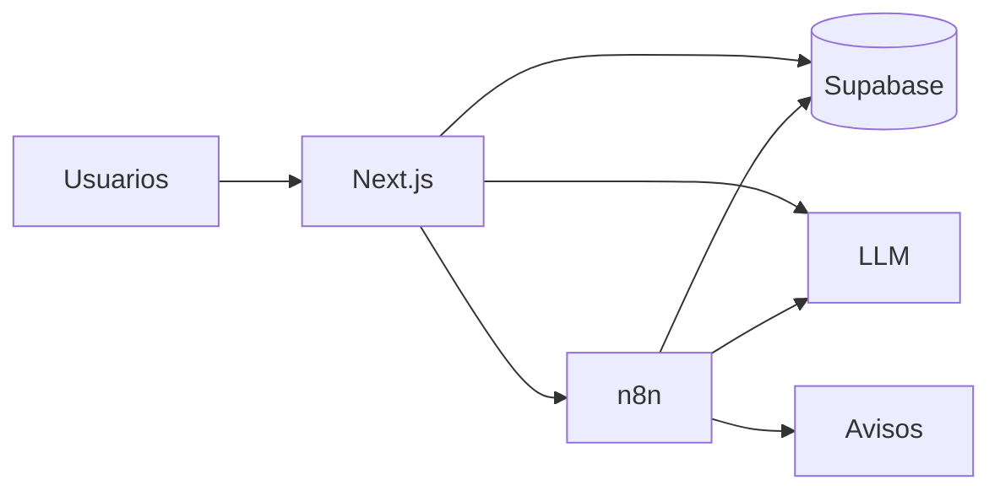

# Sistema de Admisión, Matrículas y Cobranzas

Hackatón · Track T3

## Problema

El seguimiento manual de admisiones, matrículas y pensiones consume tiempo al personal, puede retrasar los cobros y deja a las familias sin información clara sobre sus trámites y pagos. *(Hipótesis por validar.)*

## Usuario

- **Principal:** personal de secretaría y colecturía que gestiona matrículas y cobros.
- **Externo:** representante del estudiante que realiza el trámite y necesita resolver dudas.

## Arquitectura



- **Next.js:** interfaz y backend del sistema.
- **Supabase:** base de datos.
- **LLM:** chatbot por texto o voz y redacción de avisos.
- **n8n:** automatización del proceso de matrícula y de los recordatorios de pago.
## Cómo correr

Requisitos: Node 22+ y pnpm 10.

```bash
pnpm install
pnpm dev          # http://localhost:3000
```

Funciona **sin ninguna variable de entorno**: usa datos simulados en memoria (se reinician al reiniciar el servidor) y un asesor IA simulado. Copia `.env.example` a `.env.local` para activar servicios reales:

| Variable | Efecto |
|---|---|
| `ANTHROPIC_API_KEY` | El asesor y el auditor usan Claude (`ANTHROPIC_MODEL`, por defecto `claude-opus-5-5`). |
| `SUPABASE_URL` + `SUPABASE_SERVICE_ROLE_KEY` | Los datos se leen y escriben en Supabase. Aplica `supabase/migrations/` y `supabase/seed.sql` (el dataset completo; `supabase db reset` hace ambas cosas). |
| `ADMIN_PASSCODE` + `SESSION_SECRET` | Acceso al panel. En desarrollo, sin ellas se usa `admin-demo`. **En producción son obligatorias** (≥16 y ≥32 caracteres); si faltan, el panel queda cerrado. |
| `N8N_WEBHOOK_SECRET`, `N8N_OUTBOUND_WEBHOOK_URL` | Integración con n8n (ver `n8n/README.md`). Sin `N8N_WEBHOOK_SECRET` el webhook responde 401 en todos los entornos. |

### Datos

El sistema solo contiene los datos del **dataset ficticio** `dataset-ficticio-colegio/` (240 estudiantes, año 2025-2026, corte enero 2026; ver `data/README.md`). Los estudiantes y representantes se identifican con los códigos del dataset (`EST-###`, `REP-###`), porque el dataset no trae cédulas.

- Modo simulado: los CSV se cargan en memoria al arrancar y el reloj de la demo arranca el 31 ene 2026 (`DEMO_TODAY` lo cambia).
- Supabase: `pnpm db:seed` regenera `supabase/seed.sql` desde los CSV (incluye asistencia, notas, horarios y docentes).

### Datos de demostración

- Pagos (`/pagos`): estudiante `EST-001` o `MAT-2025-0001`, representante `REP-001`.
- Estado de solicitud (`/estado`): no hay solicitudes precargadas; envía una en `/admision` y usa el código y la cédula que registres.
- Panel (`/admin`): clave `admin-demo` (solo con `pnpm dev`; en `pnpm start` define `ADMIN_PASSCODE` y `SESSION_SECRET`).
- Las solicitudes nuevas reciben un código aleatorio, p. ej. `ADM-2026-K7P2QX`.

### Scripts

`pnpm dev` · `pnpm build` · `pnpm start` · `pnpm lint` · `pnpm typecheck` · `pnpm db:seed`

## Estructura

```
src/
  app/(public)/      landing, admisión, estado, pagos, asesor IA
  app/admin/         login + panel (dashboard, solicitudes, matrículas, pagos, auditoría)
  app/api/           chat (streaming), solicitudes, consultas, admin, webhook n8n, health
  ai/                proveedor Claude / simulado, prompts, auditor (reglas + IA)
  content/institution.ts   contexto institucional editable (ficticio por ahora)
  data/              repositorio: simulado en memoria o Supabase
  components/        UI glass, accesibilidad, gráficos, chat, formularios
design-system/       dirección visual (DIRECTION.md) y tokens
supabase/            migraciones SQL y semilla
n8n/                 contratos de webhooks
```

Más detalle en `docs/ARCHITECTURE.md`.
