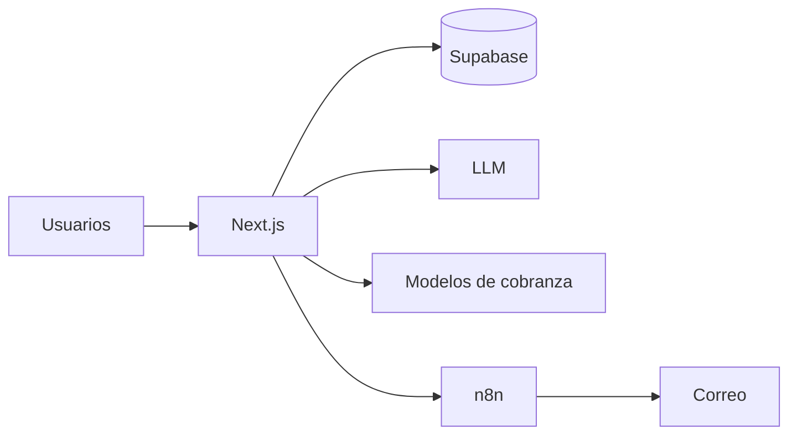

# Sistema de Admisión, Matrículas y Cobranzas

Hackatón · Track T3

## Problema

El seguimiento manual de admisiones, matrículas y pensiones consume tiempo al personal, puede retrasar los cobros y deja a las familias sin información clara sobre sus trámites y pagos. *(Hipótesis por validar.)*

## Usuario

- **Principal:** personal de secretaría y colecturía que gestiona matrículas y cobros.
- **Externo:** representante del estudiante que realiza el trámite y necesita resolver dudas.

El sitio también busca tener en cuenta a minorías, como niños con autismo y personas no videntes (ver [Accesibilidad e inclusión](#accesibilidad-e-inclusión)).

## Arquitectura



- **Next.js:** interfaz y backend del sistema.
- **Supabase:** base de datos.
- **LLM (Claude):** chatbot por texto y auditor de procesos. Sin clave de API funcionan en modo simulado o solo con reglas.
- **Modelos de cobranza:** estiman el riesgo de atraso o impago.
- **n8n:** envía por correo el código de seguimiento. Los recordatorios de pago están previstos, pero todavía no están hechos.

## Cómo correr

Requisitos: Node 22+ y pnpm 10.

```bash
pnpm install
pnpm dev          # http://localhost:3000
```

Funciona **sin ninguna variable de entorno**: usa datos simulados en memoria (se reinician al reiniciar el servidor) y un asesor IA simulado. Copia `.env.example` a `.env.local` para activar servicios reales:

| Variable | Efecto |
|---|---|
| `ANTHROPIC_API_KEY` | El asesor y el auditor usan Claude (`ANTHROPIC_MODEL`, por defecto `claude-opus-5-5`). |
| `SUPABASE_URL` + `SUPABASE_SERVICE_ROLE_KEY` | Los datos se leen y escriben en Supabase. Aplica `supabase/migrations/` y `supabase/seed.sql` (el dataset completo; `supabase db reset` hace ambas cosas). |
| `ADMIN_PASSCODE` + `SESSION_SECRET` | Acceso al panel. En desarrollo, sin ellas se usa `admin-demo`. **En producción son obligatorias** (≥16 y ≥32 caracteres); si faltan, el panel queda cerrado. |
| `N8N_WEBHOOK_SECRET`, `N8N_OUTBOUND_WEBHOOK_URL` | Integración con n8n (ver `n8n/README.md`). Sin `N8N_WEBHOOK_SECRET` el webhook responde 401 en todos los entornos. |
| `APP_URL` | URL pública de la app para los enlaces de los correos. |
| `DEMO_TODAY` | Cambia la fecha del reloj de la demo (ver Datos). |

### Datos

El sistema solo contiene los datos del **dataset ficticio** `dataset-ficticio-colegio/` (240 estudiantes, año 2025-2026, corte enero 2026; ver `data/README.md`). Los estudiantes y representantes se identifican con los códigos del dataset (`EST-###`, `REP-###`), porque el dataset no trae cédulas.

- Modo simulado: los CSV se cargan en memoria al arrancar y el reloj de la demo arranca el 31 ene 2026 (`DEMO_TODAY` lo cambia).
- Supabase: `pnpm db:seed` regenera `supabase/seed.sql` desde los CSV (incluye asistencia, notas, horarios y docentes).

### Datos de demostración

- Pagos (`/pagos`): estudiante `EST-001` o `MAT-2025-0001`, representante `REP-001`.
- Estado de solicitud (`/estado`): no hay solicitudes precargadas; envía una en `/admision` y usa el código y la cédula que registres.
- Panel (`/admin`): clave `admin-demo` (solo con `pnpm dev`; en `pnpm start` define `ADMIN_PASSCODE` y `SESSION_SECRET`).
- Las solicitudes nuevas reciben un código aleatorio, p. ej. `ADM-2026-K7P2QX`.
- Modelos de cobranza: `/admin/modelos` (familias con historial de pagos) y `/admin/nuevo-cliente` (familias nuevas).

## IA y automatización

| Parte | Cómo funciona | Límites y fallos |
|---|---|---|
| Asesor virtual (burbuja y `/asesor`) | Sin `ANTHROPIC_API_KEY` es **simulado**: responde según palabras clave. Con la clave responde Claude. No tiene voz. | En modo simulado solo cubre algunos temas. El chat avisa que el asesor puede equivocarse y, si hay un error, lo muestra en pantalla. |
| Auditor de procesos (panel) | Revisa solicitudes y pagos con reglas fijas. Con la clave, Claude además prioriza y amplía los hallazgos, sin recibir nombres, cédulas ni contactos. | Sin clave o si la IA falla, quedan los resultados de las reglas. |
| Predicción de pago (`/admin/modelos`) | Regresión logística, árbol de decisión y random forest predicen si una familia pagará puntual, tarde o no pagará el mes siguiente. | Datos sintéticos y solo 2 meses de entrenamiento. Su exactitud queda por debajo de suponer que «todos pagan puntual». Solo sirven como alerta temprana, no para sancionar. No toman en cuenta los pagos registrados en la app. |
| Familia nueva (`/admin/nuevo-cliente`) | Estima el riesgo de impago sin historial. | La señal es débil, apenas mejor que el azar. Nunca debe usarse para negar una matrícula. |
| n8n | Envía el código de seguimiento por correo (`n8n/workflows/codigo-seguimiento.json`). WhatsApp y SMTP vienen desactivados. | Sin n8n la solicitud se guarda igual y no se envía correo. Falta probar la importación en una instancia de n8n (ver `n8n/README.md`). |

## Accesibilidad e inclusión

- **Panel de accesibilidad** (icono de una persona): tema, tamaño del texto, alto contraste, reducir movimiento, reducir transparencia y fuente de lectura fácil.
- **Colores de error suaves:** usamos un rojo poco saturado, pensando en personas con sensibilidad sensorial, como algunos niños con autismo.
- **No dependemos solo del color:** el error de un campo tiene un icono y un texto, y el formulario de admisión dice qué campo falta.
- **Lectores de pantalla y teclado (ARIA):** enlace para saltar al contenido, campos con etiqueta, errores y ayudas unidos a su campo, campos obligatorios marcados, avisos del chat y de las búsquedas, y tablas de datos para los gráficos.

### Scripts

`pnpm dev` · `pnpm build` · `pnpm start` · `pnpm lint` · `pnpm typecheck` · `pnpm db:seed`

## Estructura

```
src/
  app/(public)/      landing, admisión, estado, pagos, asesor IA
  app/admin/         login + panel (dashboard, solicitudes, matrículas, pagos, auditoría, modelos, cliente nuevo)
  app/api/           chat (streaming), solicitudes, consultas, admin, webhook n8n, health
  ai/                proveedor Claude / simulado, prompts, auditor (reglas + IA)
  content/institution.ts   contexto institucional editable (ficticio por ahora)
  data/              repositorio: simulado en memoria o Supabase
  components/        UI glass, accesibilidad, gráficos, chat, formularios
  ml/                modelos exportados a JSON y su cálculo en TypeScript
Modelos/             modelos entrenados (.joblib) y scripts de Python
dataset-ficticio-colegio/  datos sintéticos (CSV)
design-system/       dirección visual (DIRECTION.md) y tokens
supabase/            migraciones SQL y semilla
n8n/                 contratos de webhooks y flujo exportado
```

Más detalle en `docs/ARCHITECTURE.md`.
