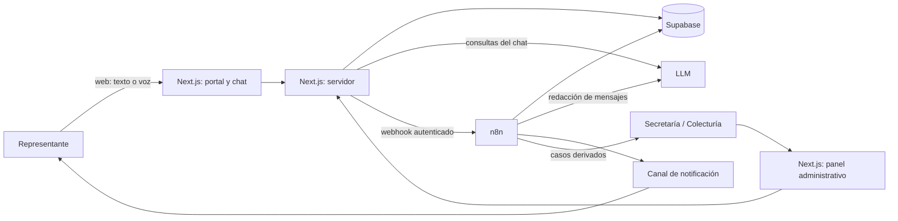

# Sistema de Admisión, Matrículas y Cobranzas

**Hackatón · Track T3: comercial y administrativo (institución educativa)**

Sistema web que gestiona el recorrido desde la solicitud de matrícula hasta el cobro de pensiones, con automatización en **n8n** y un asistente con IA que responde por **texto o voz**.

> **Estado:** primera entrega (problema, usuario y arquitectura). La solución está en construcción. El avance real figura en [Estado del proyecto](#estado-del-proyecto).

---

## 1. Problema

**¿Qué proceso de la institución consume tiempo, dinero o confianza y puede automatizarse?**
La admisión y matrícula, junto con la cobranza de matrículas y pensiones.

**Hipótesis por validar:** estos procesos dependen de seguimiento manual. El personal revisa si cada solicitud está completa, responde dudas repetidas y recuerda los pagos uno por uno. Creemos que esto afecta en tres frentes:

| Frente | Efecto esperado |
|---|---|
| Tiempo | Horas del personal en revisiones, respuestas y seguimiento repetitivo |
| Dinero | Pagos atrasados por recordatorios tardíos o inconsistentes |
| Confianza | Familias que no conocen el estado de su trámite o de sus pagos |

### Evidencia de campo

**[PENDIENTE]** Completar con entrevistas o datos. No se registran nombres ni datos personales, solo el rol de la fuente y cifras agregadas.

| Fuente (rol) | Fecha | Hallazgo |
|---|---|---|
| [PENDIENTE] | [PENDIENTE] | [PENDIENTE] |

| Dato del proceso actual | Valor | Fuente |
|---|---|---|
| Solicitudes de matrícula por periodo | [PENDIENTE] | [PENDIENTE] |
| Minutos de gestión manual por solicitud | [PENDIENTE] | [PENDIENTE] |
| Pagos vencidos por mes | [PENDIENTE] | [PENDIENTE] |
| Minutos por recordatorio manual | [PENDIENTE] | [PENDIENTE] |
| Preguntas más repetidas de las familias | [PENDIENTE] | [PENDIENTE] |

## 2. Usuario

| Usuario | Qué necesita |
|---|---|
| **Principal:** persona de secretaría o colecturía que gestiona matrículas y pensiones | Saber qué solicitudes y pagos requieren su atención, sin hacer el seguimiento caso por caso |
| **Externo:** representante del estudiante | Presentar la solicitud, conocer su estado y sus pagos, y resolver dudas por texto o voz |

**[PENDIENTE]** Describir el tipo de institución (tamaño, niveles y cómo gestiona hoy el proceso).

## 3. Solución propuesta

### Flujo principal (el de la demo en vivo)

1. El representante registra una solicitud de matrícula en el portal web.
2. La solicitud se guarda en Supabase y la aplicación avisa a n8n.
3. n8n revisa con reglas si está completa e informa lo que falta o confirma la recepción.
4. Secretaría revisa la solicitud en el panel y la **aprueba o rechaza**.
5. Al aprobarse, n8n genera las obligaciones de pago (matrícula y pensiones) según el plan configurado y envía las instrucciones.
6. Colecturía registra el pago y la matrícula queda confirmada.
7. n8n da seguimiento a los pagos próximos a vencer o vencidos y deriva los casos a una persona cuando corresponde.

En cualquier momento, el representante puede consultar al asistente por texto o voz.

### Alcance

| Prioridad | Funcionalidad |
|---|---|
| Esencial | Solicitud, revisión, aprobación, obligaciones de pago, registro del pago y cobranza automatizada |
| Esencial | Asistente por texto: requisitos, estado del trámite y pagos pendientes |
| Complementaria | Conversación por voz dentro del mismo chat |
| Complementaria | Derivación de dudas del asistente a una persona |
| Fuera de alcance | Pasarela de pagos real, facturación electrónica e integración con otros sistemas institucionales |

En este prototipo no se procesa dinero: el pago se registra manualmente desde el panel.

## 4. Arquitectura



| Componente | Tecnología | Responsabilidad |
|---|---|---|
| Frontend | Next.js | Portal del representante, panel administrativo y chat |
| Backend | Next.js (lógica en el servidor) | Permisos, reglas del negocio, consultas al LLM y llamadas a n8n |
| Datos | Supabase (Postgres, Auth, Storage) | Datos, acceso de usuarios y documentos ficticios |
| Automatización | n8n | Orquestación de solicitudes, cobros y seguimiento |
| IA | LLM: **[PENDIENTE: proveedor y modelo]** | Respuestas del asistente y redacción de recordatorios |
| Voz | Web Speech API (propuesta) | Convertir la voz en texto y leer la respuesta |
| Notificaciones | **[PENDIENTE: correo o Telegram]** | Envío de avisos a cuentas de prueba |

La aplicación llama a n8n y n8n trabaja sobre Supabase. n8n no necesita llamar a la aplicación.

### Modelo de datos inicial

`representantes` · `estudiantes` · `solicitudes` · `documentos` · `planes_pago` · `obligaciones` · `pagos` · `recordatorios` · `casos_derivados` · `registro_automatizaciones`

### Asistente con IA (texto y voz)

- La voz y el texto usan el mismo chat y la misma lógica. La voz solo cambia la forma de entrada y salida.
- El soporte de voz depende del navegador. Se probará en el equipo de la demo y el texto queda como respaldo.
- El asistente responde con la información institucional cargada y con los datos del representante autenticado.
- El servidor filtra los datos antes de enviarlos al LLM. El asistente no consulta libremente la base de datos.
- Si no tiene información suficiente, lo indica y propone derivar el caso a una persona.
- No aprueba solicitudes, no cambia montos, no registra pagos ni perdona deudas.

### Seguridad

- Seguridad por filas (RLS) en Supabase para que cada representante vea solo sus datos.
- La clave secreta de Supabase y la clave del LLM se usan solo en el servidor y en las credenciales de n8n.
- Los webhooks de n8n exigen un token secreto.
- No se suben secretos al repositorio.

## 5. Automatización con n8n

n8n mueve el proceso entre sus etapas. Las decisiones de admisión las toma una persona y los montos salen de la base de datos.

| Flujo | Disparador | Qué hace |
|---|---|---|
| **1. Recepción de solicitud** | Webhook al enviar la solicitud | Verifica datos y documentos requeridos, actualiza el estado y avisa lo que falta |
| **2. Aprobación y cobro** | Webhook al aprobar | Ejecuta en la base de datos la creación de obligaciones y envía las instrucciones de pago |
| **3. Cobranza programada** | Programación diaria (y ejecución manual para la demo) | Busca pagos por vencer o vencidos, los clasifica con reglas, redacta el aviso, lo envía, lo registra y deriva casos |
| **4. Derivación del asistente** (complementario) | Webhook desde el chat | Crea un caso y avisa a secretaría |

### Reglas de cobranza iniciales (por validar con la institución)

| Situación | Acción |
|---|---|
| Faltan 3 días para el vencimiento | Aviso preventivo |
| De 1 a 7 días de atraso | Primer recordatorio |
| De 8 a 30 días de atraso | Segundo recordatorio |
| Más de 30 días de atraso o reclamo del representante | Se detienen los avisos automáticos y el caso pasa a una persona |

### Verificaciones, límites y fallos (diseño previsto)

| Riesgo | Control |
|---|---|
| Llamada no autorizada al webhook | Se rechaza si no incluye el token secreto |
| Obligaciones o avisos duplicados | Restricciones únicas por obligación, periodo y etapa del recordatorio |
| El LLM inventa un monto o una fecha | El LLM solo redacta texto con marcadores. El flujo inserta montos y fechas desde la base de datos |
| La respuesta del LLM no es válida o el servicio falla | Si faltan marcadores o aparecen cifras, o no hay respuesta, se usa una plantilla fija |
| n8n no responde | La solicitud queda guardada como pendiente de automatización y puede reenviarse desde el panel |
| Falla el envío de un aviso | Se registra el error y no se marca como enviado |

Los flujos exportados se guardarán en `n8n/workflows/`.

## 6. Datos y privacidad

- Solo se usan **datos sintéticos o anonimizados**. No se usan datos reales de estudiantes, familias ni docentes, en cumplimiento de las reglas del reto y de la LOPDP.
- Los documentos de prueba son ficticios.
- Los datos de prueba usan correos de ejemplo. En la demo, los avisos se envían solo a cuentas de prueba del equipo, que no se guardan en el repositorio.

## 7. Cómo ejecutar el proyecto

> **Pasos previstos.** El código ejecutable aún no está completo. Estos pasos deben verificarse desde una copia limpia antes de la entrega.

**Requisitos:** Node.js, un proyecto de Supabase, una instancia de n8n y una clave de API del LLM.

1. Clonar el repositorio y entrar en su carpeta.
2. Instalar dependencias: `npm install`
3. Copiar `.env.example` como `.env.local` y completar los valores.
4. Ejecutar en Supabase los scripts de `supabase/migrations/` y luego `supabase/seed.sql` (datos sintéticos).
5. Importar en n8n los archivos de `n8n/workflows/`, configurar sus credenciales y activar los flujos.
6. Iniciar la aplicación: `npm run dev`
7. Abrir `http://localhost:3000`.

### Variables de entorno

| Variable | Uso |
|---|---|
| `NEXT_PUBLIC_SUPABASE_URL` | URL del proyecto de Supabase |
| `NEXT_PUBLIC_SUPABASE_PUBLISHABLE_KEY` | Clave publicable de Supabase |
| `SUPABASE_SECRET_KEY` | Clave secreta, solo para el servidor |
| `LLM_API_KEY` | Clave del proveedor del LLM |
| `LLM_MODEL` | Modelo utilizado |
| `N8N_WEBHOOK_BASE_URL` | URL base de los webhooks de n8n |
| `N8N_WEBHOOK_SECRET` | Token para autenticar los webhooks |

### Estructura prevista

```text
.
├── src/                  # Aplicación Next.js
├── supabase/
│   ├── migrations/       # Tablas, funciones y políticas RLS
│   └── seed.sql          # Datos sintéticos
├── n8n/
│   └── workflows/        # Flujos exportados en JSON
├── .env.example
├── AI_USAGE.md
├── PRIOR_WORK.md
└── README.md
```

## 8. Viabilidad e impacto

| Pregunta | Respuesta |
|---|---|
| ¿Quién la usa? | Secretaría, colecturía y representantes |
| ¿Quién la paga y sostiene? | Propuesta: la institución. **[PENDIENTE: validar y definir responsable técnico]** |
| ¿Cuánto cuesta al mes? | **[PENDIENTE: alojamiento, Supabase, n8n, LLM, notificaciones y mantenimiento]** |
| ¿Cuál es el siguiente paso? | Validar el proceso y las reglas con la institución y probar un piloto de alcance reducido. Antes de usar datos reales se debe definir su tratamiento conforme a la LOPDP |

### Estimación de ahorro

```text
Horas ahorradas al mes = [S × (Sa − Sd) + R × (Ra − Rd)] / 60
Ahorro neto mensual    = horas ahorradas × costo por hora − costo mensual de operación
```

| Variable | Significado | Valor |
|---|---|---|
| S | Solicitudes al mes | [PENDIENTE] |
| Sa / Sd | Minutos por solicitud antes / después | [PENDIENTE] |
| R | Recordatorios al mes | [PENDIENTE] |
| Ra / Rd | Minutos por recordatorio antes / después | [PENDIENTE] |

Los valores "después" son estimaciones hasta medirlos con el sistema funcionando. Como las matrículas son estacionales, conviene calcular por separado los meses de matrícula.

## Estado del proyecto

- [x] Problema, usuario y arquitectura propuestos
- [ ] Validación del problema con el mentor
- [ ] Evidencia de campo
- [ ] Base de datos, políticas RLS y datos sintéticos
- [ ] Portal de solicitud y panel administrativo
- [ ] Flujo 1: recepción de solicitud
- [ ] Flujo 2: aprobación y cobro
- [ ] Flujo 3: cobranza programada
- [ ] Asistente por texto
- [ ] Voz en el chat
- [ ] Flujo 4: derivación del asistente
- [ ] Flujos de n8n exportados al repositorio
- [ ] Prueba de punta a punta y demo en vivo

## Equipo

| Integrante | Usuario de GitHub | Rol |
|---|---|---|
| [PENDIENTE] | [PENDIENTE] | [PENDIENTE] |

## Declaraciones

- [PRIOR_WORK.md](./PRIOR_WORK.md): recursos y trabajo de terceros.
- [AI_USAGE.md](./AI_USAGE.md): uso de inteligencia artificial.