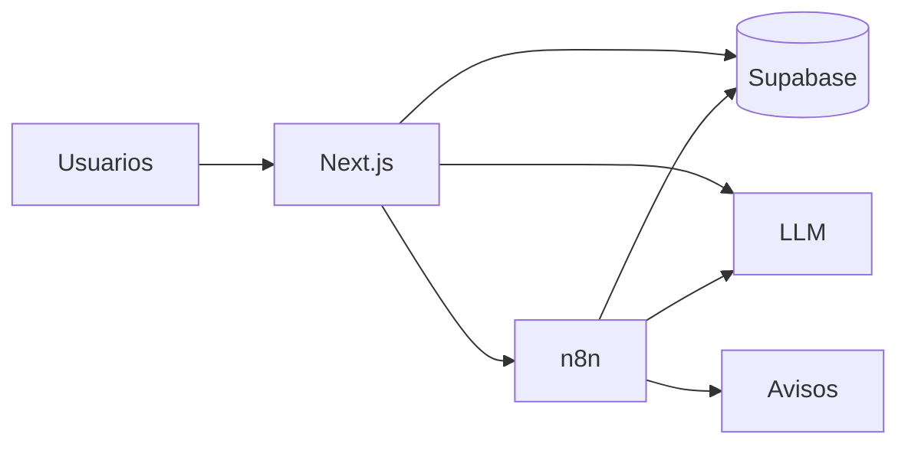

# Sistema de Admisión, Matrículas y Cobranzas

Hackatón · Track T3

## Problema

El seguimiento manual de admisiones, matrículas y pensiones consume tiempo al personal, puede retrasar los cobros y deja a las familias sin información clara sobre sus trámites y pagos. *(Hipótesis por validar.)*

## Usuario

- **Principal:** personal de secretaría y colecturía que gestiona matrículas y cobros.
- **Externo:** representante del estudiante que realiza el trámite y necesita resolver dudas.

## Arquitectura

- **Next.js:** interfaz y backend del sistema.
- **Supabase:** base de datos.
- **LLM:** chatbot por texto o voz y redacción de avisos.
- **n8n:** automatización del proceso de matrícula y de los recordatorios de pago.